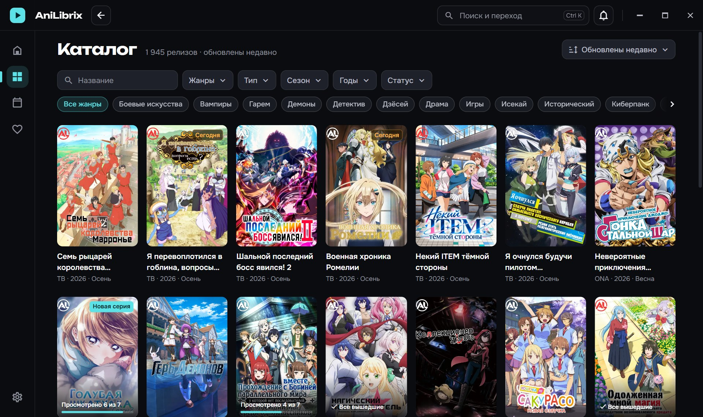

<h1>
  <picture>
    <source media="(prefers-color-scheme: dark)" srcset=".github/assets/logo-dark.svg">
    
  </picture>
</h1>

Неофициальный десктопный клиент [AniLiberty](https://aniliberty.top) (бывш. AniLibria) для Windows, Linux
и macOS на Tauri 2 и Vue 3. Видео, описания и расписание берутся из открытого API AniLiberty.

> Animoon не связан с командой AniLiberty и не является её официальным приложением.



> Это новая версия, переписанная с Electron на Tauri. Старая Electron-версия (AniLibrix 1.6.8) — тег
> `electron-1.6.8`. Что сделано и что дальше — в [`docs/STATE.md`](docs/STATE.md).

## Возможности

- **Главная**: афиша со следующей непросмотренной серией, полка «Новые серии» (начатые — первыми), выход
  серий за сегодня.
- **Каталог**: поиск по названию, жанры, тип, сезон, годы, статус, сортировка; фильтры запоминаются.
  Превью релиза при наведении на постер.
- **Расписание** по дням недели, сегодня — первым.
- **Избранное** по годам выхода, со сворачиванием и переходом к году.
- **Страница релиза**: серии кадрами или списком, отметки просмотра, «Продолжить» с места остановки.
- **Плеер HLS**: качество 480/720/1080p, скорость, отметки опенинга и эндинга, «Пропустить опенинг»,
  автопереход к следующей серии с отсчётом, список серий, полный экран.
- **Аккаунт AniLiberty**: вход по логину и паролю, избранное, прогресс просмотра синхронизируется с тайм-кодами
  аккаунта — после переустановки или на другом компьютере он сохраняется.
- **Уведомления** о новых сериях релизов из избранного (проверка раз в 10 минут; если окно не активно — системное уведомление).
- **Поиск и переход** из любого экрана: `Ctrl K`, ищет и разделы, и релизы.
- **Масштаб интерфейса**: на большом мониторе интерфейс сам становится крупнее; вручную — 100–175%
  в настройках.
- **Автообновление**: новая версия скачивается и ставится из приложения (проверка раз в 6 часов и кнопкой
  в настройках).
- Зеркала API переключаются сами, если основное недоступно.

Торренты, Discord Rich Presence, Chromecast, аналитика и реклама из старой версии убраны.

## Установка

Установщики — на странице [Releases](https://github.com/a3v4r/animoon/releases):

- **Windows** — `*-setup.exe`. Установщик не подписан сертификатом, поэтому при первом запуске SmartScreen
  покажет «Система Windows защитила ваш компьютер»: «Подробнее» → «Выполнить в любом случае».
- **macOS** — `*.dmg`, один файл для Apple Silicon и Intel. Приложение не нотаризовано: при первом запуске
  macOS не даст его открыть — «Системные настройки» → «Конфиденциальность и безопасность» → «Всё равно открыть».
- **Linux** — `.deb`, `.rpm` или `.AppImage`. Для видео нужен GStreamer с кодеками (`gstreamer1.0-plugins-good`,
  `-bad`, `gstreamer1.0-libav`): deb ставит их сам, AppImage везёт с собой. Нужен дистрибутив не старше
  Ubuntu 22.04 / Debian 12 / Mint 21 (glibc 2.35).

Дальше приложение обновляется само.

## Горячие клавиши плеера

| Клавиша | Действие |
|---|---|
| `Space`, `K` | Пауза / воспроизведение |
| `←` / `→` | Назад / вперёд на 5 секунд |
| `J` / `L` | Назад / вперёд на 10 секунд |
| `↑` / `↓` | Громкость |
| `M` | Выключить звук |
| `F` | Полный экран |
| `Esc` | Отменить автопереход, закрыть список серий, выйти из полного экрана |
| `N` | Следующая серия |
| `S` | Пропустить опенинг |

## Разработка

Нужны:

- Node.js `20.19+` или `22.12+`;
- pnpm 9 (можно без установки — через `npx -y pnpm@9`);
- Rust `1.90+` и системные зависимости Tauri для своей ОС — см.
  [Prerequisites](https://v2.tauri.app/start/prerequisites/) (на Windows — Microsoft C++ Build Tools и WebView2,
  он уже есть в Windows 10/11; на Linux — `webkit2gtk-4.1` и др.; на macOS — Xcode Command Line Tools).

```bash
pnpm install
pnpm tauri dev      # окно приложения с горячей перезагрузкой
pnpm typecheck      # проверка типов
pnpm tauri build    # установщики в src-tauri/target/release/bundle (нужен ключ подписи, см. ниже)
```

`pnpm dev` запускает только интерфейс в браузере на `http://127.0.0.1:1420`: управление окном и уведомления
там не работают, а запросы к API идут через `fetch` браузера и могут упираться в CORS.

Отладка окна на Windows: запустить с `WEBVIEW2_ADDITIONAL_BROWSER_ARGUMENTS=--remote-debugging-port=9222`,
DevTools-протокол — на `http://127.0.0.1:9222/json/list`.

### Устройство

| Что | Где |
|---|---|
| Окно, плагины, права | `src-tauri/` (`tauri.conf.json`, `capabilities/`) |
| Клиент API v1 с зеркалами | `src/api/` (спецификация — `docs/api-v1.json`) |
| Экраны | `src/views/` |
| Каркас окна, плеер, общие компоненты | `src/components/` |
| Состояние: прогресс, аккаунт, настройки, расписание | `src/stores/` |
| Оформление «Кинотеатр»: цвета, шрифты, общие классы | `src/styles/`, макеты — `docs/design/` |

Стек: Tauri 2, Vite 8, Vue 3.5 + TypeScript, Vuetify 4, Pinia, vue-router, hls.js. Запросы к API идут через
`tauri-plugin-http` (Rust), а не через `fetch` WebView: без CORS.

CSP задан в `tauri.conf.json` и действует только в собранном приложении (в `pnpm tauri dev` его нет):
проверять через `pnpm tauri build --debug`. Если AniLiberty сменит домен видео (`*.libria.fun`) или зеркал,
их нужно поправить в трёх местах: `MIRRORS` в `src/api/http.ts`, `http:default` в `capabilities/default.json`
и CSP.

### Выпуск версии

1. Поднять версию в `package.json`, `src-tauri/tauri.conf.json` и `src-tauri/Cargo.toml` (одинаковую).
2. Закоммитить и запушить тег: `git tag v2.1.0 && git push origin v2.1.0`.
3. GitHub Actions (`.github/workflows/release.yml`) соберёт Windows, Linux и macOS и создаст черновик релиза
   с установщиками и `latest.json`.
4. Проверить черновик и опубликовать его («Set as latest»). Только после этого установленные копии увидят
   обновление.

Обновления подписываются ключом Tauri. Он нужен и в CI (секреты `TAURI_SIGNING_PRIVATE_KEY`,
`TAURI_SIGNING_PRIVATE_KEY_PASSWORD`), и для локальной `pnpm tauri build` — в тех же переменных окружения.
Если ключ потерять, уже установленные копии больше не смогут обновиться.

## Ещё не готово

Подпись установщиков сертификатами (Windows, Apple) — без неё при первой установке система предупреждает.
Своя настройка прокси (сейчас приложение идёт через системный прокси или VPN).

## Лицензия

[MIT](LICENSE). Проект начинался с [AniLibrix](https://github.com/pavloniym/anilibrix) от pavloniym — спасибо
за идею; код с тех пор переписан полностью. Шрифты Onest и Unbounded — SIL Open Font License (`src/assets/fonts`), иконки —
Material Design Icons (Apache 2.0).
